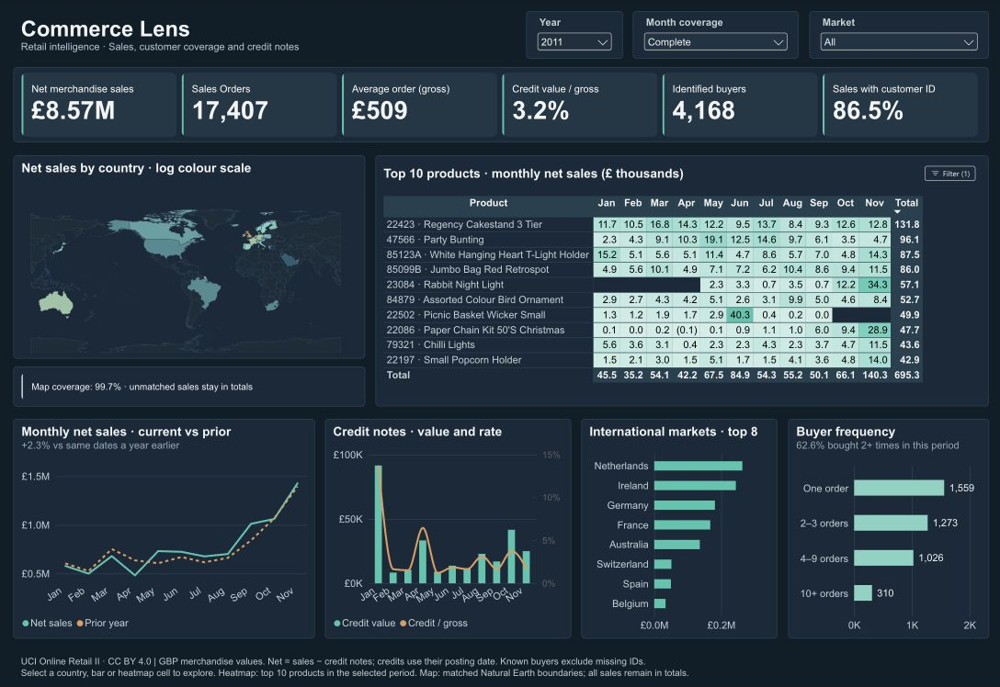

# Commerce Lens: a Power BI retail sales report on public data

Commerce Lens is a single-page Power BI report on merchandise sales, product seasonality, international markets, credit notes and customer-ID coverage for a UK online retailer. It uses the public **UCI Online Retail II** dataset, which covers December 2009 to December 2011. It is an independent portfolio project, not client work.

The report focuses on a few practical questions: whether sales comparisons cover equivalent dates, which products and markets contribute most, and how missing customer IDs affect buyer analysis. The visual overview is backed by documented cleaning rules, DAX measures and independent calculation checks.

I built it with AI assistance. Claude reviewed the design and calculations. Codex, an AI coding agent, made the final changes in Power BI Service. The repository documents the implementation, metric definitions and validation so readers can inspect how the report works.



*Default view: 2011, complete months (January to November), all markets. The live report sits in a private Power BI workspace, so this repository shows a screenshot instead. The [test record](docs/test-record.md) documents the interactions tested in Power BI Service; the image itself is static.*

| | |
|---|---|
| **Data** | UCI Online Retail II, CC BY 4.0. 1,067,371 source rows; 1,021,272 sale and credit lines kept after cleaning |
| **Period** | 1 December 2009 to 9 December 2011 (the source ends part-way through December 2011) |
| **Tools** | Power BI Service, Power Query (M), DAX, TMDL; Python (pandas, standard library) and SQL for checking |
| **Scope** | Historical snapshot. No live feed, no scheduled refresh, no cost or profit data |

---

## Business questions

1. How did net merchandise sales compare with the same dates a year earlier, including in a period that is only partly covered?
2. Which products drive each month, and how seasonal are they?
3. Outside the UK, which markets matter most?
4. How much of the sales value can be tied to an identified customer, and how often do identified customers come back within the period?
5. How large are credit notes relative to gross sales, and what drives the spikes?

## Findings

**Scope.** Unless stated otherwise, every figure is for **2011, complete months (1 January to 30 November), all markets**, compared with **1 January to 30 November 2010**. These are observations about a historical dataset. They are not results caused by this report.

- **Overall sales.** Net merchandise sales were **£8,572,828**, up **2.3%** on £8,377,738 for the same dates in 2010.
- **Orders and order value.** Sales orders fell **3.7%**, to 17,407, while average gross order value rose **7.0%**, to £509.
  - *Calculated in the reconciliation script, not shown on the report page.*
- **UK and international.** UK net sales were flat at **+0.2%** (£7.19m, 83.9% of the total). International net sales grew **15.1%** (£1.38m). The Netherlands was the largest international market, at £263.0K.
- **Missing customer IDs.** In January–November 2011, 13.5% of gross sales had no customer ID. The gap is uneven: **15.7%** of UK gross sales lack an ID against **1.9%** of international gross sales. UK orders without an ID average **£1,036** gross against **£430** for UK orders with one. Buyer analysis therefore excludes orders without IDs, which have a higher average gross value in this selection; the number of distinct buyers behind those orders is unknown.
  - *The market split and order values come from the reconciliation script.*
- **Credit notes.** The 3.2% credit/gross figure includes one same-day reversal: an order of 74,215 units worth £77,183.60, placed and credited on 18 January 2011 (invoices 541431 and C541433). That one credit is 27.2% of the period's credits. Without the pair, the ratio is 2.36%.
- **Seasonality.** November 2011 was the highest month, at £1.43m net. The ten best-selling products together account for £695.3K, 8.1% of net sales. Regency Cakestand 3 Tier leads, at £131.8K.
- **Repeat purchasing.** 62.6% of the 4,168 identified buyers placed two or more orders within the period. The bands are:
  - one order: 1,559 buyers;
  - 2 to 3 orders: 1,273;
  - 4 to 9 orders: 1,026;
  - 10 or more: 310.

  This is repeat purchasing within the period. It is not a retention or churn rate.
- **The partial month.** Net sales for **1 to 9 December 2011** were £440,400, **9.8%** above **1 to 9 December 2010**. This is not a full-December result.
  - The credit/gross ratio for those nine days is 28.3%.
  - Almost all of that comes from one £168,469.60 sale that was credited in full on 9 December 2011 (invoices 581483 and C581484).
  - Without the pair, the ratio is 1.26%.

## Metric definitions

| Metric | Definition | What it is not |
|---|---|---|
| Gross merchandise sales | Sum of quantity × unit price on retained sale lines | Not revenue after VAT, discounts or delivery |
| Merchandise credits | Value of negative-quantity lines on C-prefixed (credit) invoices, **on the credit's posting date** | Not matched back to the original sale date |
| Net merchandise sales | Gross merchandise sales minus merchandise credits | Not audited revenue or profit |
| Sales orders | Distinct sale invoice numbers (credit invoices excluded) | |
| Average order (gross) | Gross merchandise sales ÷ sales orders | |
| Credit value / gross | Merchandise credits ÷ gross merchandise sales | Not an item return rate |
| Identified buyers | Distinct customer IDs with at least one sale invoice in the selection | Lines with no customer ID are excluded here but stay in all sales totals |
| Sales with customer ID | Gross sales with a customer ID ÷ gross sales | |
| Repeat share | Identified buyers with 2 or more sale invoices in the selection ÷ identified buyers | Not retention or churn |
| Like-for-like prior year | The same calendar dates twelve months earlier, limited to dates the source covers | Blank when no comparable period exists |
| Map coverage | Net sales in countries with a matched boundary ÷ net sales | Unmatched countries stay in every total |

## Data preparation

Two implementations apply the same cleaning rules:

- **Python:** a pandas script (`python/clean_retail.py`) produced the CSVs in `data/`.
- **Power Query:** the query in `powerbi/power-query/Sales.pq` builds the model's Sales table directly from the UCI workbook.

What the rules do:

- **Duplicates.** Exact duplicates are found on all eight original columns, within and across the two source sheets, before any text is normalised.
- **Codes and countries.** Invoice and stock codes are trimmed and upper-cased. EIRE, USA and RSA become Ireland, United States and South Africa.
- **Exclusions.**
  - Zero or negative prices.
  - Postage, bank charges, manual adjustments, test codes and gift vouchers.
  - Malformed invoice numbers.
  - Lines where the invoice type and the sign of the quantity disagree.
- **Missing customer IDs.** They become `Unknown` and are kept; 227,089 retained lines have no ID.
- **Product labels.** Each stock code gets its most frequent cleaned description.

Every source row gets exactly one disposition in `data/RowAudit.csv`:

| Disposition | Rows |
|---|---|
| Included sale | 1,003,357 |
| Included credit | 17,915 |
| Duplicate across sheets | 22,202 |
| Duplicate within sheet | 12,133 |
| Zero or negative unit price | 6,019 |
| Non-merchandise or test line | 5,745 |
| **Total** | **1,067,371** |

## Model

The model is a star schema in import mode.

- **Fact table.** `Sales` holds one row per retained invoice line.
- **Dimensions.**
  - `Date`: 2009 to 2011, with a complete-month flag.
  - `Product`: 4,739 stock codes.
  - `Country`: 43.
  - `Customer`: 5,875 IDs plus `Unknown`.
- **Relationships.** All four are many-to-one, with single-direction filtering.
- **Disconnected tables.**
  - `PurchaseBand` holds the order-count bands.
  - `RowAudit` and `QualityMonthly` hold data-quality figures.
- **Measures.** The model holds 91: 36 base measures, 41 added for this report, and 14 diagnostic measures used by another report on the same model. Three calculated columns support the map and month ordering.
- **Not yet changed:**
  - Auto date/time is still on, which adds hidden date tables the report does not use.
  - Korea is not mapped to South Korea, because the source label is ambiguous.

Power Query, measure and relationship definitions are in [`powerbi/`](powerbi/README.md). The measure files match the expressions in the final PBIX exactly, ignoring whitespace.

## DAX: like-for-like comparisons

The data starts on 1 December 2009 and stops on 9 December 2011. The original previous-year measure in this model shifted the selected calendar dates without checking source coverage. With the original slicer context, this produced unequal comparison periods at the dataset boundaries. Recomputing those periods from the CSVs gives:

- Selecting the partial month would compare **1 to 9 December 2011 with the whole of December 2010** and show **−41.9%**.
- Selecting 2010 would compare it with a 2009 that holds only December, and show **+1,073.8%**.

The report's measure shifts only the dates the source actually covers. It returns blank when the shifted period would start before the data does, or when more than one year is selected:

```DAX
measure 'CL Net Sales PY' =
    VAR FirstD = [CL Source First Date]
    VAR LastD = [CL Source Last Date]
    VAR Cur = FILTER ( VALUES ( 'Date'[Date] ), 'Date'[Date] >= FirstD && 'Date'[Date] <= LastD )
    VAR PriorDates = SELECTCOLUMNS ( Cur, "PriorDate", EDATE ( 'Date'[Date], -12 ) )
    RETURN
        IF (
            [CL PY Like For Like Available] = 1,
            CALCULATE ( [Net Merchandise Sales], REMOVEFILTERS ( 'Date' ), TREATAS ( PriorDates, 'Date'[Date] ) )
        )
```

Results in the report:

| Selection | Comparison shown |
|---|---|
| 2011, complete months | +2.3% vs same dates a year earlier |
| 2011, partial month | +9.8% vs same dates a year earlier (1 to 9 December 2010) |
| 2010 | "Full-period prior-year coverage unavailable" |

The same pattern feeds the prior-year orders, gross sales, credits and buyer measures. Captions and the map colour scale are also measures: the map uses log10(1 + net sales), so markets other than the UK are distinguishable.

## Interactivity

These are implemented in the report definition and were tested in Power BI Service's reading view; see the [test record](docs/test-record.md).

- **Year dropdown.** Strict single-select, so the monthly grid and prior-year logic always see one year.
- **Month coverage dropdown.** Complete months or the partial month.
- **Market dropdown.** UK or international.
- **Click to cross-filter.** Clicking a bar in the international ranking or a heatmap row filters the rest of the page. For example, clicking the Netherlands bar changes net sales to £263.00K, with 87 orders and 8 identified buyers. The map accepts the same kind of selection, but a map click was not tested separately.
- **Tooltips.** The map tooltip shows actual net sales and orders, not the log value used for colour.
- **Reset to default.** Power BI's control restores 2011 / Complete / All.

## Validation

**Re-runnable** (CSV level, in `validation/` and `sql/`):

- `verify_final.py` uses only Python's standard library: eight scenarios, nine assertions, all passing.
- `independent_claims_check.py` is a separate pandas implementation. It covers 11 data-shape checks and every figure in this README: 32 of 32 pass.
- The SQL aggregate in `sql/` returns the same 2011 totals when run in SQLite.

**Recorded in Power BI Service** (14 November 2026; not re-run for this repository):

- native DAX queries for the 2011, partial and 2010 cases, and for empty or multi-year selections;
- slicer, click and reset tests in reading view;
- save and reload;
- one Performance Analyzer capture, with visual durations of 108 to 1,342 ms. That is one measured run, not a performance guarantee.

The Service results match the CSV recomputation for the tested aggregates. This shows that the Power Query pipeline and the pandas pipeline agree at that level.

**Not tested:**

- opening or refreshing the PBIX in Power BI Desktop;
- a clean-machine rebuild;
- refresh from the UCI URL;
- re-running the Python cleaning from the raw workbook;
- a mobile layout (none is defined);
- keyboard and screen-reader use.

## Reproduce the checks

```bash
git clone https://github.com/usman5642/commerce-lens-power-bi.git
cd commerce-lens-power-bi
# Download commerce-lens-cleaned-data.zip from the Releases page and extract Sales.csv into data/
python3 validation/verify_final.py
# Expected last line of the JSON: "status": "PASS: 9 reconciliation assertions"

# Optional, install the pinned validation dependency first:
python3 -m venv .venv
# macOS/Linux: source .venv/bin/activate
# Windows PowerShell: .venv\Scripts\Activate.ps1
python3 -m pip install -r validation/requirements.txt
python3 validation/independent_claims_check.py data validation/claims_local.json
```

Further options:

- **View the report in Power BI Desktop (Windows).** Download `Commerce_Lens_Final.pbix` from the Releases page, if it is attached there. The data is already imported. This route has not been tested.
- **Rebuild from the CSVs.** Use the queries in `powerbi/power-query/local-csv-variant/` with the measure files in `powerbi/model/`. This is documented but has not been tested end to end.

## Limitations

- **Historical data.** This is a fixed 2009 to 2011 snapshot. There are no costs, margins, web sessions, marketing spend or channel data, so the report makes no profit, conversion or causal claims.
- **Credit dates.** Credits sit on their posting date, so a credit can fall in a different month or year from the sale it reverses.
- **Customer IDs.** Buyer measures exclude lines without a customer ID; sales totals include them.
- **The map.**
  - Boundaries load from an external URL at view time, and the map includes Antarctica.
  - Channel Islands, Unspecified, European Community, West Indies and Korea have no matched boundary. Together they hold 0.3% of 2011 net sales, and they stay in every total.
- **Accessibility.** Alt text and a reviewed tab order have not been added, and no keyboard or screen-reader audit has been done.
- **Report definition.** The exported files in `powerbi/report-definition/` are a reference copy, not a complete PBIP project.

## Repository layout

```
commerce-lens-power-bi/
├── README.md
├── LICENSE                  MIT, for code and documentation
├── DATA_LICENSE.md          CC BY 4.0 attribution and changes
├── data/                    seven small cleaned tables (Sales.csv is in the Release)
├── docs/
│   ├── images/commerce-lens-overview.png
│   ├── test-record.md       what was tested, where and by what
│   ├── implementation-record.txt
│   └── portfolio-walkthrough.txt
├── powerbi/
│   ├── report-definition/   exported report layout (reference, not a PBIP)
│   ├── power-query/         queries used by the model
│   └── model/               measures (TMDL), partitions and relationships
├── python/                  original cleaning scripts (not re-run here)
├── sql/                     one SQL cross-check
└── validation/              re-runnable checks and their outputs
```

## Source and licence

Data: Chen, D. (2012). *Online Retail II* [Dataset]. UCI Machine Learning Repository. https://doi.org/10.24432/C5CG6D. Licensed under [CC BY 4.0](https://creativecommons.org/licenses/by/4.0/). The tables here are cleaned and restructured; the changes are listed in [`data/README.md`](data/README.md).

Map boundaries: `world-atlas` (derived from Natural Earth), loaded at view time and not redistributed.

Code and documentation: MIT licence; see [`LICENSE`](LICENSE).
